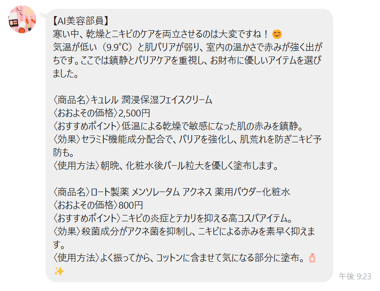

# 利用者の肌の情報と気象情報を用いたAI化粧品選出システムの開発

<!--- 
- 元ページ: `/openrtm/ja/project/contest2025-si2025-0026`
- Drupal node ID: `7313`
- 投稿者: root
--->
- 投稿日時: 水, 2025-11-05 14:10
- 問合先（メールアドレス）: mika.karasuda@gmail.com
- OS: Windows
- 言語: Python
- OpenRTM ver.: 2.0
- Average: 0 まだ投票はありません
- タグ: RTM contest 2025
- 最終更新日時: 月, 2025-12-01 01:22

### 概要

近年拡大が続く化粧品市場において、利用者は季節変動や日々の肌コンディションといった多様な要因に基づき、パーソナライズされた製品選定が求められている。この課題に対応するため、私たちはAIを活用した化粧品選定システムを開発した。 本システムは、気象情報、利用者の年齢や肌の悩みに関する情報、および利用者の肌の赤みを数値化したデータの3種類の情報を入力プロンプトとして統合する。このプロンプトに基づき、AIが個々の利用者に最適な化粧品を選出する。

### コンポーネント概要

・気象情報を取得する機能 ・ユーザー情報を取得する機能 ・カメラを起動して写真を撮り赤みを分析する機能 ・上記の要素からプロンプトを作成し推薦結果をAIに生成させる機能 ・生成させたものをLINEに送信する機能

### 仕様

・言語：Python ・OS：Windows 11

### 資料

・ [ソースコード](https://github.com/makeuprtmiddle-afk/COSMETICS_REC_COMPONENTS)

・ [マニュアル](https://github.com/makeuprtmiddle-afk/COSMETICS_REC_COMPONENTS/blob/main/manual.pdf)

### 実装例

・送信させたメッセージ例

<!-- ・送信させたメッセージ例-->
